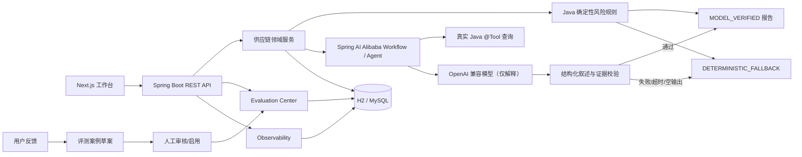
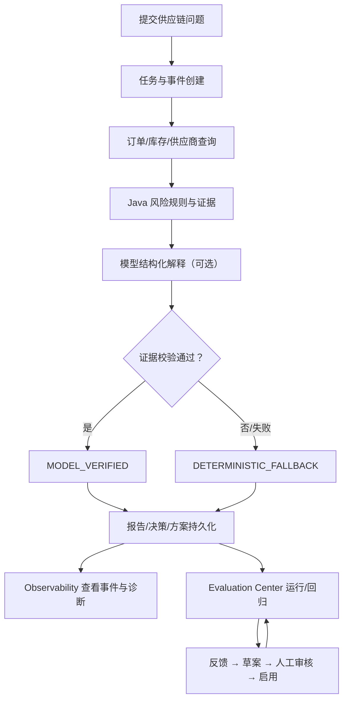

# ChainPilot — 供应链智能决策与 Agent 评测工作台

ChainPilot 是一个面向供应链风险分析与处置决策的 Java / AI Agent 项目。它在
[Spring AI Alibaba DataAgent](https://github.com/spring-ai-alibaba/DataAgent) 的应用骨架上，
增加了供应链领域服务、确定性风险规则、结构化模型叙述校验、决策与沙箱边界、评测中心和运行观测。

> 当前供应链订单/库存/供应商是**本地模拟数据**，用于学习和演示，不连接真实 ERP/WMS，
> 不会执行真实采购、库存或订单写入。


## 项目定位

项目重点不是“让大模型自由生成业务结论”，而是把可验证的 Java 规则和受约束的模型解释结合起来：

- 风险分数、等级、计分贡献和业务证据由 Java 确定性规则产生。
- 模型只解释已有证据；结构化输出必须通过订单、证据 ID、数值、推荐和 dataGap 校验。
- 校验失败、超时、不可用或空输出时回退确定性结果，且不会覆盖正式风险数据。
- Agent 评测、运行观测和人工反馈形成可追溯闭环，而不是只展示一次聊天结果。

## 主要能力

- 订单延期、库存短缺、供应商履约风险分析与结构化证据。
- 风险报告、决策建议、处置方案、人工确认和沙箱演练。
- 情景推演、共享基线、多候选方案比较和模拟隔离。
- Agent Evaluation Center：固定案例集、历史运行、对比、指标、单案例重跑。
- Agent 运行观测：真实任务事件、模型/工具/回退诊断、耗时和失败追踪。
- 人工反馈 → 案例草案 → 人工补充预期 → 审核 → 启用 → 离线回归。
- 模型配置、手动连接测试、四态就绪预检、AGENT 启动门禁和安全错误分类。
- 独立的 Next.js 工作台，保留上游 DataAgent 的聊天、知识库、数据源和模型管理能力。

## 系统架构



关键边界：

- 模型负责**解释和受约束的编排**，不修改 Java 规则计算出的风险分数、等级和证据。
- 情景模拟、沙箱执行和评测记录与真实业务数据隔离；沙箱不代表真实 ERP 写入。
- 反馈不是标准答案：草案必须由人工填写预期和断言，审核启用后才进入评测。
- 真实模型尚未配置，模型执行路径图不代表已经通过真实模型 E2E。

更完整的架构说明见 [docs/ARCHITECTURE_CHAINPILOT.md](docs/ARCHITECTURE_CHAINPILOT.md)。

## 核心业务闭环



## 技术栈

| 层 | 技术 |
| --- | --- |
| 后端 | Java 17、Spring Boot 3.4.8、Spring AI 1.1.2、Spring AI Alibaba 1.1.2.2 |
| 工作流 | Spring AI Alibaba StateGraph、Java `@Tool`、确定性规则服务 |
| 数据 | H2（本地演示，文件库）、MySQL 8（可选/集成测试）、JdbcTemplate/MyBatis |
| 评测 | 版本化案例集、OFFLINE 确定性执行、显式 AGENT 运行、运行持久化 |
| 观测 | 任务事件、模型/工具/回退事件、Micrometer/OpenTelemetry 适配 |
| 前端 | Next.js 16.4.2、React 19、TanStack Query 5、Tailwind CSS 4 |
| 测试 | JUnit 5、Mockito、H2、真实 MySQL IT、Vitest、TypeScript、ESLint |

## 目录结构

```text
data-agent-management/          Spring Boot 后端
  src/main/java/.../supplychain 供应链领域、规则、决策、沙箱、模拟、观测
  src/main/java/.../evaluation  评测、反馈、案例与运行持久化
  src/main/java/.../...         上游 DataAgent 基础能力与模型配置
  src/main/resources/evaluation 版本化评测案例资源
data-agent-frontend-next/       ChainPilot Next.js 工作台
data-agent-frontend-nuxt/       上游 Nuxt 前端（本阶段不修改；历史内容保留）
docs/                           架构、演示、归因、简历与面试材料
scripts/                        只读 Smoke Test
.github/workflows/              上游 CI 与 ChainPilot CI
```

## 环境要求

- JDK 17
- Maven Wrapper（仓库自带 `mvnw` / `mvnw.cmd`）
- Node.js 22.x（Next.js 16 要求 Node.js 20.9+；CI 使用 Node 22）
- 可选：MySQL 8 仅用于隔离集成测试，不是本地演示的必要条件
- 不需要 API Key 即可运行模拟数据、确定性规则、离线评测和只读 Smoke Test

## 启动后端

Windows PowerShell：

```powershell
$env:JAVA_HOME = 'C:\path\to\jdk-17'
.\mvnw.cmd -pl data-agent-management spring-boot:run "-Dspring-boot.run.profiles=h2"
```

Linux/macOS：

```bash
export JAVA_HOME=/path/to/jdk-17
./mvnw -pl data-agent-management spring-boot:run -Dspring-boot.run.profiles=h2
```

默认端口 **8065**。H2 profile 使用 `data-agent-management/data/nl2sql_database` 文件数据库，
便于重启后保留任务与报告；该文件属于本地数据，不应提交到 Git。

不要把 `-am` 加进 `spring-boot:run`：它会让 Spring Boot 插件在父 POM 上执行并报
“Unable to find a suitable main class”。只指定业务模块即可。

也可以用打包后的 jar 启动。Java 进程的工作目录决定相对 H2 路径，下面先进入模块目录，
保证与 Maven 启动使用同一个数据库：

```bash
./mvnw -pl data-agent-management -DskipTests package
cd data-agent-management
java -jar target/chainpilot-management-1.0.0-SNAPSHOT.jar --spring.profiles.active=h2
```

## 启动前端

```bash
cd data-agent-frontend-next
npm ci
npm run dev
```

浏览器打开 `http://localhost:3000`。开发模式在启动时读取 `CHAINPILOT_BACKEND_URL`，
把 `/api/**`、`/uploads/**` 代理到该地址，默认 `http://localhost:8065`。

生产构建与启动（当前验收使用 3002 端口）：

```bash
CHAINPILOT_BACKEND_URL=http://localhost:8065 npm run build
npm run start -- -p 3002
```

Windows PowerShell：

```powershell
$env:CHAINPILOT_BACKEND_URL = 'http://localhost:8065'
npm run build
npm run start -- -p 3002
```

生产模式的代理目标在 `npm run build` 时写入路由清单；更换后端地址后需要重新构建。
如果后端不在 8065，开发模式可以直接在启动前设置：

```bash
CHAINPILOT_BACKEND_URL=http://127.0.0.1:8066 npm run dev
```

## 本地只读 Smoke Test

启动前后端后运行：

```powershell
powershell -NoProfile -ExecutionPolicy Bypass -File .\scripts\chainpilot-smoke-test.ps1
```

默认只执行 GET 请求：

- `/echo/ok`
- `/api/supply-chain/orders`
- `/api/supply-chain/inventory?sku=SKU-MCU-001`
- `/api/supply-chain/suppliers`
- `/api/supply-chain/observability/summary`
- `/api/agent-evaluation/capabilities`
- `/api/agent-evaluation/cases`
- `/api/agent-evaluation/runs?limit=1`
- `/api/agent-evaluation/feedback/stats`
- `/api/model-config/check-ready`
- 前端 `/`

它不会创建任务、反馈、评测或模拟，不会清空数据库，不会触发连接测试，也不会调用真实模型。
模型未就绪会标记为 `BLOCKED`，但不把外部未配置条件误报为 Smoke Test 失败。

## 演示数据初始化（新环境可选）

新数据库没有任务、方案、执行、评测和反馈时，可显式运行：

```powershell
powershell -NoProfile -ExecutionPolicy Bypass -File .\scripts\chainpilot-demo-seed.ps1
```

脚本通过公开 API 创建一条带 `[DEMO-SEED]` 标记的完整链路：

`分析任务 → 决策任务 → 方案对比 → 模拟 → 处置方案 → 选中 → 沙箱执行 → 离线评测 → 反馈`

安全边界：

- 只应连接本地演示后端；脚本不会调用模型，方案使用确定性解释，评测为 `OFFLINE`。
- 重复执行会按标记复用已有记录，不会重复创建任务、方案、执行、反馈或评测。
- 数据库已有任务但没有演示标记时，脚本会拒绝写入；确需在已有数据库追加演示链时显式加
  `-AllowExistingData`。
- 脚本不会清空、重置或修改已有任务、订单、库存和供应商数据。

成功后会输出分析/决策/方案/执行/反馈/评测 ID，以及示例入口
`/supply-chain?demo=supplier-delay`。

后端任务历史默认只保留 24 小时，方案/执行/评测/反馈不受该任务保留策略影响。演示当天可重跑
脚本；已有 `[DEMO-SEED]` 任务仍存在时会直接复用，不会重复写入。

## 模型配置与真实 Agent 前置条件

1. 打开 `http://localhost:3000/system/model-config`（生产端口按实际配置）。
2. 新增并激活 CHAT 模型；需要向量检索的案例再配置 EMBEDDING。
3. 点击「测试」并确认一次真实连接测试；测试结果和错误为当前后端进程作用域。
4. 进入 `/agent-evaluation`，选择案例并查看 CHAT/EMBEDDING 依赖与费用提示。
5. 只有 CHAT 已验证、所选案例依赖满足且用户显式确认后，AGENT 运行才会启动。

当前工作流案例声明 `chatRequired=true`、`embeddingRequired=false`；没有 EMBEDDING 时
知识检索使用本地词典检索。连接测试失败会返回安全分类错误码，例如
`AUTHENTICATION_FAILED`、`CONNECTION_TIMEOUT`、`ENDPOINT_UNAVAILABLE`，
不返回原始异常、Authorization 或 URL 凭据。

**当前状态：模型配置列表为空，真实模型 Agent E2E 被阻塞。** 没有真实调用、费用、
provider usage 或 `MODEL_VERIFIED` 运行证据；不能把假模型测试或离线评测当作真实模型验收。

## 演示路径

完整的 3–5 分钟演示脚本见 [docs/DEMO_WALKTHROUGH.md](docs/DEMO_WALKTHROUGH.md)。

1. 首页 `/`：项目定位、能力概览和视觉主题。
2. 供应链分析 `/supply-chain`：提交问题，查看风险订单、证据、模型/规则来源和任务历史。
3. 决策 `/supply-chain/decision`：生成提案、查看候选方案并人工确认。
4. 处置与沙箱 `/supply-chain/disposal`：情景推演、方案比较、模拟隔离和沙箱资格。
5. 历史 `/supply-chain/history`：任务、报告、事件和筛选。
6. 评测中心 `/agent-evaluation`：案例、运行、指标、对比和人工反馈。
7. 运行观测 `/agent-observability`：任务事件、工具/模型/回退诊断。
8. 模型配置 `/system/model-config`：配置、连接测试和就绪状态。

关键 API：

| 方法 | 路径 | 说明 |
| --- | --- | --- |
| `POST` | `/api/supply-chain/analysis/tasks` | 提交异步供应链分析任务 |
| `GET` | `/api/supply-chain/analysis/tasks` | 任务历史，支持状态筛选与分页 |
| `GET` | `/api/supply-chain/analysis/tasks/{taskId}/report` | 读取报告 |
| `GET` | `/api/supply-chain/analysis/tasks/{taskId}/events` | 读取真实任务事件 |
| `GET` | `/api/supply-chain/observability/summary` | 观测汇总（只读） |
| `POST` | `/api/agent-evaluation/runs` | 启动评测；AGENT 需要显式确认和前置条件 |
| `GET` | `/api/agent-evaluation/capabilities` | 案例数量、模型就绪和门禁信息 |
| `GET` | `/api/model-config/check-ready` | 只读模型就绪状态，不调用模型 |
| `POST` | `/api/model-config/test/{id}` | 用户触发一次真实连接测试 |

## 测试与构建

后端 H2：

```bash
./mvnw -pl data-agent-management test
```

若本机 Windows 中文路径导致 JaCoCo agent 无法加载，可在测试编译后使用同一 Surefire 引擎直接执行：

```powershell
.\mvnw.cmd -pl data-agent-management test-compile -DskipTests
.\mvnw.cmd -pl data-agent-management surefire:test -DfailIfNoTests=false
```

MySQL 集成测试必须使用隔离的 `chainpilot_mysql_it` 或 Testcontainers，不会自动回落到 H2：

```bash
./mvnw -pl data-agent-management surefire:test \
  -Dtest="SupplyChainMySqlPersistenceIT,SupplyChainMySqlHttpIntegrationIT,EvaluationMySqlPersistenceIT,EvaluationMySqlLegacyUpgradeIT,FeedbackMySqlPersistenceIT" \
  -Dchainpilot.mysql.integration=true \
  -Dchainpilot.mysql.url="jdbc:mysql://127.0.0.1:3306/chainpilot_mysql_it?useSSL=false&allowPublicKeyRetrieval=true" \
  -Dchainpilot.mysql.username=YOUR_TEST_USER \
  -Dchainpilot.mysql.password=YOUR_TEST_PASSWORD
```

前端：

```bash
cd data-agent-frontend-next
npm test
npx tsc --noEmit
npm run lint
npm run build
```

最终验收轮本机回归（2026-10-21）：后端 H2 **1963/1963**，Vitest **96/96**，
TypeScript、ESLint、Build 通过；真实浏览器完整写链路 **18/18**、全站路由 **17/17**、可见交互巡检 **35/35**，
控制台 0 错误、网络 0 个 4xx/5xx。MySQL IT **23/23** 为上一阶段结果，本轮未重跑
（本轮无 schema/DDL 变更，且未启动隔离 MySQL）。测试数量是回归证据，不等同于业务效果或代码质量。

CI：新增 [`.github/workflows/chainpilot-ci.yml`](.github/workflows/chainpilot-ci.yml)，覆盖 JDK 17
后端 H2 测试和 Node 22 前端的 Vitest、TS、Lint、Build；默认不启动 MySQL、不调用真实模型。
后端 CI 使用 `test-compile` + `surefire:test` 两步命令，以避开 JaCoCo agent 在部分非 ASCII
工作区路径下创建 `jacoco.exec` 失败的问题；执行的是同一批 JUnit 测试，不跳过测试。
仓库原有的上游 CI 仍保留，其中多数 job 只在上游仓库运行，历史 Nuxt 前端检查也不再代表当前入口。

## 当前限制

- 真实模型未配置，真实 Agent E2E 未完成；只能用假 Provider/测试替身验证边界。
- 供应链数据为模拟数据，不代表真实企业数据或生产性能。
- 沙箱与情景推演不写入真实 ERP/库存；MySQL 验证覆盖隔离测试库，不代表生产 HA、TLS 或权限模型。
- 连接测试验证状态为当前后端进程作用域，重启后需要重新测试。
- 评测案例与反馈流程已实现离线回归；真实模型质量、成本与大样本统计仍待验证。
- 没有对外宣称上游 PR 或企业用户数据。

## 上游项目与许可证

- 上游：[spring-ai-alibaba/DataAgent](https://github.com/spring-ai-alibaba/DataAgent)
- 许可证：Apache License 2.0（见 [LICENSE](LICENSE)）
- ChainPilot 在 DataAgent 基础上保留并扩展应用架构；详细贡献边界、
  上游来源和未完成/不可核实事项见 [docs/UPSTREAM_AND_CONTRIBUTION.md](docs/UPSTREAM_AND_CONTRIBUTION.md)。
- 本项目**未声称**已向 DataAgent 提交 PR；Git 历史仅显示本地导入快照。

## 文档索引

- [架构说明](docs/ARCHITECTURE_CHAINPILOT.md)
- [上游与贡献边界](docs/UPSTREAM_AND_CONTRIBUTION.md)
- [演示与验收指南](docs/DEMO_GUIDE.md)
- [3–5 分钟演示脚本](docs/DEMO_WALKTHROUGH.md)
- [截图索引](docs/SCREENSHOTS.md)
- [发布前检查清单](docs/PUBLISH_CHECKLIST.md)
- [简历项目简介](docs/RESUME_PROJECT_BRIEF.md)
- [面试准备指南](docs/INTERVIEW_GUIDE.md)
- [模块梳理](docs/CHAINPILOT_MODULES.md)

## 安全

- 模型 Key 只通过模型配置页面提交到后端，列表接口返回掩码；不要写入源码、日志或截图。
- H2 文件数据库、MySQL 测试库和 `.env` 不应提交到 Git。
- 真实模型连接测试和 AGENT 运行可能产生费用；必须由用户主动触发并确认。
- 详细安全边界见架构文档和演示指南。
