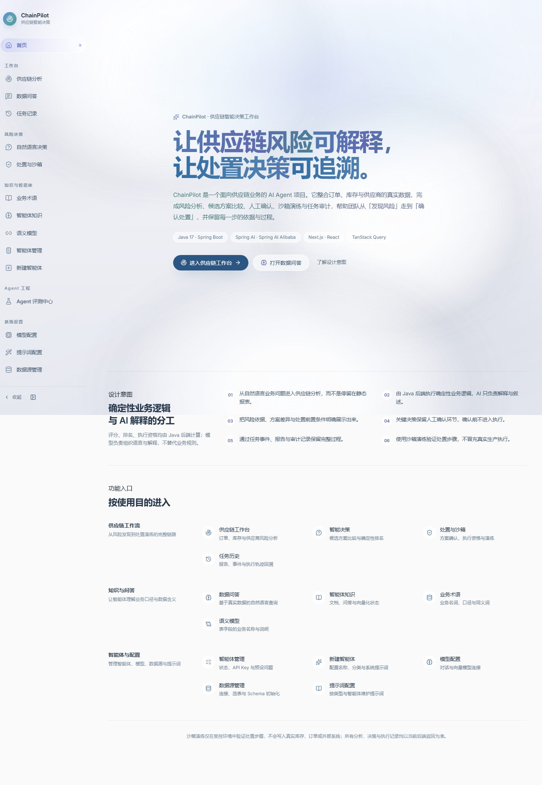
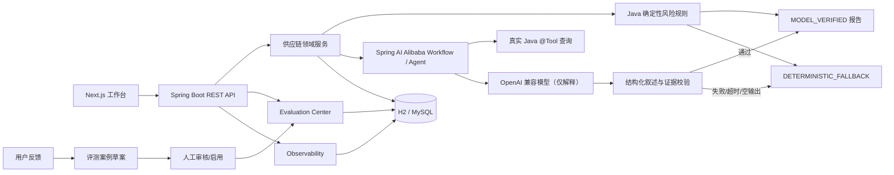
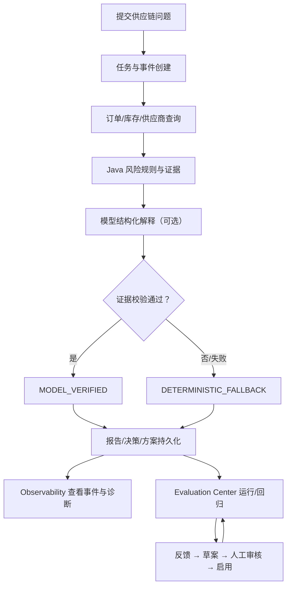

# ChainPilot — 供应链智能决策与 Agent 评测工作台

ChainPilot 是一个面向供应链风险分析与处置决策的 Java / AI Agent 项目。它在
[Spring AI Alibaba DataAgent](https://github.com/spring-ai-alibaba/DataAgent) 的应用骨架上，
增加了供应链领域服务、确定性风险规则、结构化模型叙述校验、决策与沙箱边界、评测中心和运行观测。

> 当前供应链订单/库存/供应商是**本地模拟数据**，用于学习和演示，不连接真实 ERP/WMS，
> 不会执行真实采购、库存或订单写入。



## 项目定位

项目重点不是“让大模型自由生成业务结论”，而是把可验证的 Java 规则和受约束的模型解释结合起来：

- 风险分数、等级、计分贡献和业务证据由 Java 确定性规则产生。
- 模型只解释已有证据；结构化输出必须通过订单、证据 ID、数值、推荐和 dataGap 校验。
- 校验失败、超时、不可用或空输出时回退确定性结果，且不会覆盖正式风险数据。
- Agent 评测、运行观测和人工反馈形成可追溯闭环，而不是只展示一次聊天结果。

## 主要能力

- 订单延期、库存短缺、供应商履约风险分析与结构化证据。
- 风险报告、决策建议、处置方案、人工确认和沙箱演练。
- 情景推演、共享基线、多候选方案比较和模拟隔离。
- Agent Evaluation Center：固定案例集、历史运行、对比、指标、单案例重跑。
- Agent 运行观测：真实任务事件、模型/工具/回退诊断、耗时和失败追踪。
- 人工反馈 → 案例草案 → 人工补充预期 → 审核 → 启用 → 离线回归。
- 模型配置、手动连接测试、四态就绪预检、AGENT 启动门禁和安全错误分类。
- 独立的 Next.js 工作台，保留上游 DataAgent 的聊天、知识库、数据源和模型管理能力。

## 系统架构



关键边界：

- 模型负责**解释和受约束的编排**，不修改 Java 规则计算出的风险分数、等级和证据。
- 情景模拟、沙箱执行和评测记录与真实业务数据隔离；沙箱不代表真实 ERP 写入。
- 反馈不是标准答案：草案必须由人工填写预期和断言，审核启用后才进入评测。
- 真实模型尚未配置，模型执行路径图不代表已经通过真实模型 E2E。

更完整的架构说明见 [docs/ARCHITECTURE_CHAINPILOT.md](docs/ARCHITECTURE_CHAINPILOT.md)。

## 核心业务闭环



## 技术栈

| 层 | 技术 |
| --- | --- |
| 后端 | Java 17、Spring Boot 3.4.8、Spring AI 1.1.2、Spring AI Alibaba 1.1.2.2 |
| 工作流 | Spring AI Alibaba StateGraph、Java `@Tool`、确定性规则服务 |
| 数据 | H2（本地演示，文件库）、MySQL 8（可选/集成测试）、JdbcTemplate/MyBatis |
| 评测 | 版本化案例集、OFFLINE 确定性执行、显式 AGENT 运行、运行持久化 |
| 观测 | 任务事件、模型/工具/回退事件、Micrometer/OpenTelemetry 适配 |
| 前端 | Next.js 16.4.2、React 19、TanStack Query 5、Tailwind CSS 4 |
| 测试 | JUnit 5、Mockito、H2、真实 MySQL IT、Vitest、TypeScript、ESLint |

## 目录结构

```text
data-agent-management/          Spring Boot 后端
  src/main/java/.../supplychain 供应链领域、规则、决策、沙箱、模拟、观测
  src/main/java/.../evaluation  评测、反馈、案例与运行持久化
  src/main/java/.../...         上游 DataAgent 基础能力与模型配置
  src/main/resources/evaluation 版本化评测案例资源
data-agent-frontend-next/       ChainPilot Next.js 工作台
data-agent-frontend-nuxt/       上游 Nuxt 前端（本阶段不修改；历史内容保留）
docs/                           架构、演示、归因、简历与面试材料
scripts/                        只读 Smoke Test
.github/workflows/              上游 CI 与 ChainPilot CI
```

## 环境要求

- JDK 17
- Maven Wrapper（仓库自带 `mvnw` / `mvnw.cmd`）
- Node.js 22.x（Next.js 16 要求 Node.js 20.9+；CI 使用 Node 22）
- 可选：MySQL 8 仅用于隔离集成测试，不是本地演示的必要条件
- 不需要 API Key 即可运行模拟数据、确定性规则、离线评测和只读 Smoke Test

## 启动后端

Windows PowerShell：

```powershell
$env:JAVA_HOME = 'C:\path\to\jdk-17'
.\mvnw.cmd -pl data-agent-management spring-boot:run "-Dspring-boot.run.profiles=h2"
```

Linux/macOS：

```bash
export JAVA_HOME=/path/to/jdk-17
./mvnw -pl data-agent-management spring-boot:run -Dspring-boot.run.profiles=h2
```

默认端口 **8065**。H2 profile 使用 `data-agent-management/data/nl2sql_database` 文件数据库，
便于重启后保留任务与报告；该文件属于本地数据，不应提交到 Git。

不要把 `-am` 加进 `spring-boot:run`：它会让 Spring Boot 插件在父 POM 上执行并报
“Unable to find a suitable main class”。只指定业务模块即可。

也可以用打包后的 jar 启动。Java 进程的工作目录决定相对 H2 路径，下面先进入模块目录，
保证与 Maven 启动使用同一个数据库：

```bash
./mvnw -pl data-agent-management -DskipTests package
cd data-agent-management
java -jar target/chainpilot-management-1.0.0-SNAPSHOT.jar --spring.profiles.active=h2
```

## 启动前端

```bash
cd data-agent-frontend-next
npm ci
npm run dev
```

浏览器打开 `http://localhost:3000`。开发模式在启动时读取 `CHAINPILOT_BACKEND_URL`，
把 `/api/**`、`/uploads/**` 代理到该地址，默认 `http://localhost:8065`。

生产构建与启动（当前验收使用 3002 端口）：

```bash
CHAINPILOT_BACKEND_URL=http://localhost:8065 npm run build
npm run start -- -p 3002
```

Windows PowerShell：

```powershell
$env:CHAINPILOT_BACKEND_URL = 'http://localhost:8065'
npm run build
npm run start -- -p 3002
```

生产模式的代理目标在 `npm run build` 时写入路由清单；更换后端地址后需要重新构建。
如果后端不在 8065，开发模式可以直接在启动前设置：

```bash
CHAINPILOT_BACKEND_URL=http://127.0.0.1:8066 npm run dev
```

## 访问与使用（无需登录）

ChainPilot 当前**没有注册/登录体系**：启动前后端后直接访问即可，无账号、无权限门槛，
所有数据（任务、评测、反馈）按本地数据库归属，不做多用户隔离。

核心业务流程（一条完整链路）：

1. 打开首页 `/`，点击「项目演示」进入 `/demo` 演示中心。
2. 在 `/supply-chain` 提交一个分析问题（如「哪些订单存在延期风险？」），等待任务完成。
3. 打开任务报告，查看风险评分、证据明细与数据缺口（评分由 Java 确定性规则计算）。
4. 进入 `/supply-chain/decision` 对报告生成决策提案，比较候选方案并人工确认。
5. 在 `/supply-chain/disposal` 对已确认方案做情景模拟或沙箱演练（不写真实业务数据）。
6. 在 `/supply-chain/history` 与 `/agent-observability` 回溯任务事件与诊断。

第三方 AI 模型为可选增强：不配置模型时分析、评分与离线评测全部可用（见上文
「模型配置与真实 Agent 前置条件」）；配置 CHAT 模型并通过连接测试后，AGENT 工作流
评测与模型解释叙述才会解锁。

## Docker 启动（可选）

仓库提供三种镜像与一份自托管编排（构建上下文均为仓库根目录）：

```bash
# 仅后端（默认 H2 文件库，数据在容器 /app/data）
docker build -f deploy/Dockerfile.backend -t chainpilot-backend .

# 仅前端（构建参数注入后端地址）
docker build -f deploy/Dockerfile.frontend --build-arg CHAINPILOT_BACKEND_URL=http://backend:8065 -t chainpilot-frontend .

# 自托管全家桶：MySQL 8 + 后端 + 前端，仅暴露前端 3000 端口
# 需要先在 deploy/.env 写入 MYSQL_ROOT_PASSWORD（该文件不得提交）
docker compose -f deploy/docker-compose.public.yml --env-file deploy/.env up -d --build
```

说明：镜像构建与 compose 编排脚本随项目交付，但**本轮验收未实际执行 Docker 构建/启动**，
运行结果以本机 Maven + npm 方式为准；生产环境建议在前端前再加 HTTPS 反向代理。

## 本地只读 Smoke Test

启动前后端后运行：

```powershell
powershell -NoProfile -ExecutionPolicy Bypass -File .\scripts\chainpilot-smoke-test.ps1
```

默认只执行 GET 请求：

- `/echo/ok`
- `/api/supply-chain/orders`
- `/api/supply-chain/inventory?sku=SKU-MCU-001`
- `/api/supply-chain/suppliers`
- `/api/supply-chain/observability/summary`
- `/api/agent-evaluation/capabilities`
- `/api/agent-evaluation/cases`
- `/api/agent-evaluation/runs?limit=1`
- `/api/agent-evaluation/feedback/stats`
- `/api/model-config/check-ready`
- 前端 `/`

它不会创建任务、反馈、评测或模拟，不会清空数据库，不会触发连接测试，也不会调用真实模型。
模型未就绪会标记为 `BLOCKED`，但不把外部未配置条件误报为 Smoke Test 失败。

## 演示数据初始化（新环境可选）

新数据库没有任务、方案、执行、评测和反馈时，可显式运行：

```powershell
powershell -NoProfile -ExecutionPolicy Bypass -File .\scripts\chainpilot-demo-seed.ps1
```

脚本通过公开 API 创建一条带 `[DEMO-SEED]` 标记的完整链路：

`分析任务 → 决策任务 → 方案对比 → 模拟 → 处置方案 → 选中 → 沙箱执行 → 离线评测 → 反馈`

安全边界：

- 只应连接本地演示后端；脚本不会调用模型，方案使用确定性解释，评测为 `OFFLINE`。
- 重复执行会按标记复用已有记录，不会重复创建任务、方案、执行、反馈或评测。
- 数据库已有任务但没有演示标记时，脚本会拒绝写入；确需在已有数据库追加演示链时显式加
  `-AllowExistingData`。
- 脚本不会清空、重置或修改已有任务、订单、库存和供应商数据。

成功后会输出分析/决策/方案/执行/反馈/评测 ID，以及示例入口
`/supply-chain?demo=supplier-delay`。

后端任务历史采用引用保护策略：未被方案、提案、反馈或评测结果引用的终态任务默认保留 24 小时、
最多 1000 条；被持久业务记录引用的任务会随业务记录保留，避免产生失效 taskId。清理无引用任务时，
其持久化事件一并删除。任务取消采用数据库原子状态转换：只有 `ACCEPTED/RUNNING` 可转为 `CANCELLED`；
成功/失败/已取消任务的重复取消只返回当前终态，不会覆盖。执行流程在节点、工具和持久化前检查取消信号；
无法物理中止的在途模型请求返回后也不会被写成成功结果。多实例下执行实例在节点和工具边界按主键读取任务状态，
不依赖内存广播；取消状态与 `TASK_CANCELLED` 事件在同一数据库事务中写入，事件失败会回滚取消状态。
事件序号在任务内通过锁定读分配并在唯一约束冲突时重试，避免多实例并发追加造成序号冲突。
事件追加先锁定任务行再分配序号，避免同一任务的多事务并发在事件索引上互相死锁。
取消导致的模型调用中断按取消传播，不记录为模型失败；跨实例无法物理中止的在途模型仍可能在
`TASK_CANCELLED` 之后返回，这些真实发生过的调用与降级会以原事件类型保留审计，但状态被标记为
`CANCELLED` 并在摘要中写明「late response ignored」，因此时间线不会把迟到的响应读成已生效的结果，
也不会产生成功业务结果。
实际传播延迟为下一个检查点，进程内信号只降低同一实例的发现延迟。
多实例部署前提：所有权不在 JVM 里，而在共享数据库里——任务用
`chainpilot_analysis_task.owner_instance_id / lease_expires_at / fence_version`，AGENT 评测用
`chainpilot_evaluation_lock` 的一行锁。因此横向扩容要求：① 所有实例连接同一个业务数据库，且该数据库的
事务与条件更新语义有效（隔离测试实测于 MySQL 8.0.43 / InnoDB）；② 每个实例的 `chainpilot.instance-id`
唯一，未显式配置时启动生成随机 UUID；③ Spring 调度保持启用，续约与过期回收都由 `@Scheduled` 驱动，
关闭调度即无人续约也无人回收；④ 租约一律与数据库时钟（`SELECT CURRENT_TIMESTAMP`）比较，
实例之间的时钟偏差不影响判定，但 MySQL 的 `CURRENT_TIMESTAMP` 只有秒精度。
仍在支持范围之外的是同一 JVM 内多数据源/多 Spring 上下文：持久取消检查器与租约管理器都是进程级单例，
一个进程只对应一个业务数据源。单实例本地演示（H2 文件库）不受影响，此时所有权与租约只是退化为单持有者。

多实例能力边界（只列有证据的部分）：
- 已在隔离 MySQL 上用两个真实 Spring Boot 进程实测：任务租约互斥与续约、跨实例取消、
  持有者被强杀后按租约到期回收为 `FAILED / LEASE_EXPIRED` 且不重放 Graph、评测运行互斥（第二实例返回 409
  且不提交第二个真实运行）、非持有者轮询只读、终态同事务释放锁、旧 fence 的写入被数据库拒绝；
- 未验证：生产默认租约参数（任务 TTL 15 分钟、评测 TTL 10 分钟、续约/回收 30 秒）下的长时运行与故障恢复
  （上述实测使用的是缩短的测试参数）、真实模型 Agent E2E、备份与恢复演练、HA/主从、TLS、最小权限账号、
  多实例压测与运维监控。多实例不等于已完成生产级 HA 验收。
情景对比记录是独立的持久化分析对象，以 `comparison_id` 管理，不绑定 `task_id`；取消任务不删除已提交的
对比记录，也不会将其展示或持久化为任务成功结果。对比记录可继续在处置工作台查看并用于创建方案；
如未来需要按任务追溯来源，需产品确认后新增审计元数据，当前不采用破坏性删除。演示当天可重跑脚本；已有 `[DEMO-SEED]` 任务仍存在时会直接复用，不会重复写入。

## 模型配置与真实 Agent 前置条件

1. 打开 `http://localhost:3000/system/model-config`（生产端口按实际配置）。
2. 新增并激活 CHAT 模型；需要向量检索的案例再配置 EMBEDDING。
3. 点击「测试」并确认一次真实连接测试；测试结果和错误为当前后端进程作用域。
4. 进入 `/agent-evaluation`，选择案例并查看 CHAT/EMBEDDING 依赖与费用提示。
5. 只有 CHAT 已验证、所选案例依赖满足且用户显式确认后，AGENT 运行才会启动。

当前工作流案例声明 `chatRequired=true`、`embeddingRequired=false`；没有 EMBEDDING 时
知识检索使用本地词典检索。连接测试失败会返回安全分类错误码，例如
`AUTHENTICATION_FAILED`、`CONNECTION_TIMEOUT`、`ENDPOINT_UNAVAILABLE`，
不返回原始异常、Authorization 或 URL 凭据。

**当前状态：模型配置列表为空，真实模型 Agent E2E 被阻塞。** 没有真实调用、费用、
provider usage 或 `MODEL_VERIFIED` 运行证据；不能把假模型测试或离线评测当作真实模型验收。

## 演示路径

比赛演示的唯一操作文档见 [docs/DEMO_WALKTHROUGH.md](docs/DEMO_WALKTHROUGH.md)（启动、数据准备、
逐步操作与预期结果、故障恢复），功能状态清单见 [docs/FEATURE_STATUS.md](docs/FEATURE_STATUS.md)。

1. 首页 `/`：项目定位、能力概览和视觉主题。
2. 演示中心 `/demo`：全部业务模块的功能卡片入口，按「完整可运行 / 部分可用 / 暂不可用」三档如实标注状态；AGENT 模式状态由后端 `/api/agent-evaluation/capabilities` 实时判定。
3. 供应链分析 `/supply-chain`：提交问题，查看风险订单、证据、模型/规则来源和任务历史。
4. 决策 `/supply-chain/decision`：生成提案、查看候选方案并人工确认。
5. 处置与沙箱 `/supply-chain/disposal`：情景推演、方案比较、模拟隔离和沙箱资格。
6. 历史 `/supply-chain/history`：任务、报告、事件和筛选。
7. 评测中心 `/agent-evaluation`：案例、运行、指标、对比和人工反馈。
8. 运行观测 `/agent-observability`：任务事件、工具/模型/回退诊断。
9. 模型配置 `/system/model-config`：配置、连接测试和就绪状态。

关键 API：

| 方法 | 路径 | 说明 |
| --- | --- | --- |
| `POST` | `/api/supply-chain/analysis/tasks` | 提交异步供应链分析任务 |
| `GET` | `/api/supply-chain/analysis/tasks` | 任务历史，支持状态筛选与分页 |
| `POST` | `/api/supply-chain/analysis/tasks/{taskId}/cancel` | 取消排队/执行中的任务；终态任务幂等返回 |
| `GET` | `/api/supply-chain/analysis/tasks/{taskId}/report` | 读取报告 |
| `GET` | `/api/supply-chain/analysis/tasks/{taskId}/events` | 读取真实任务事件 |
| `GET` | `/api/supply-chain/observability/summary` | 观测汇总（只读） |
| `POST` | `/api/agent-evaluation/runs` | 启动评测；AGENT 需要显式确认和前置条件 |
| `GET` | `/api/agent-evaluation/capabilities` | 案例数量、模型就绪和门禁信息 |
| `GET` | `/api/model-config/check-ready` | 只读模型就绪状态，不调用模型 |
| `POST` | `/api/model-config/test/{id}` | 用户触发一次真实连接测试 |

## 测试与构建

后端 H2：

```bash
./mvnw -pl data-agent-management test
```

若本机 Windows 中文路径导致 JaCoCo agent 无法加载，可在测试编译后使用同一 Surefire 引擎直接执行：

```powershell
.\mvnw.cmd -pl data-agent-management test-compile -DskipTests
.\mvnw.cmd -pl data-agent-management surefire:test -DfailIfNoTests=false
```

MySQL 集成测试必须使用隔离的 `chainpilot_mysql_it` 或 Testcontainers，不会自动回落到 H2：

```bash
./mvnw -pl data-agent-management surefire:test \
  -Dtest="SupplyChainMySqlPersistenceIT,SupplyChainMySqlHttpIntegrationIT,EvaluationMySqlPersistenceIT,EvaluationMySqlLegacyUpgradeIT,FeedbackMySqlPersistenceIT" \
  -Dchainpilot.mysql.integration=true \
  -Dchainpilot.mysql.url="jdbc:mysql://127.0.0.1:3306/chainpilot_mysql_it?useSSL=false&allowPublicKeyRetrieval=true" \
  -Dchainpilot.mysql.username=YOUR_TEST_USER \
  -Dchainpilot.mysql.password=YOUR_TEST_PASSWORD
```

前端：

```bash
cd data-agent-frontend-next
npm test
npx tsc --noEmit
npm run lint
npm run build
```

最终验收轮本机回归（2026-10-22）：后端 H2 **1978/1978**，真实 MySQL 8.0.43 IT **34/34**，
双 JVM 跨实例取消、正常完成、完成前边界竞争和完成后迟到取消均验证通过；Vitest **113/113**，
TypeScript、ESLint、Build 通过。最终代码真实浏览器回归：**19/19 入口**通过（17 个主路由 +
`/agent`、`/agent/1` 重定向入口；含 `/dashboard` 别名），完整写链路 **18/18**，错误状态 **12/12**，
重复提交/校验 **7/7**，342px 移动端 **9/9 无横向溢出**；任务生命周期 **11/11**（MySQL + 本地假模型，
明确为 MOCK）。数据库初始化/升级/备份恢复见 [DATABASE_RELEASE.md](docs/DATABASE_RELEASE.md)。
测试数量是回归证据，不等同于业务效果或代码质量。

同日晚些的第 40 轮（真实模型验收前置修复，零付费）重新实测：后端 H2 **2015/2015**、
0 失败 0 错误 0 跳过，`checkstyle:check` **0 violations**；本轮未运行 MySQL IT、未启动第二个 JVM、
未调用任何真实模型，上述 34/34 与双 JVM 结论仍是此前隔离环境的实测结果。
第 41 轮（Tool Calling 预算与状态语义，零付费）在同一隔离条件下独占重跑：后端 H2 **2025/2025**、
0 失败 0 错误 0 跳过，Checkstyle 0 violations；新增的是本地回环与 H2 测试（`RealModelToolCallBudgetTest`
6 例、`SupplyChainBudgetAbortStateTest` 4 例），未修改生产代码，未运行 MySQL IT 与双 JVM，未调用真实模型。
第 42 轮（修复降级假通过）独占重跑：后端 H2 **2033/2033**、0 失败 0 错误 0 跳过，Checkstyle 0 violations；
本轮改了生产评测断言（4 个需要模型参与的 AGENT 案例新增模型参与必需断言）并补 8 条回归测试，
未运行 MySQL IT 与双 JVM，未启用真实模型授权开关、未调用任何真实模型。
第 43 轮（评测中心 AGENT 真实模型验收 harness）独占重跑：后端 H2 **2045/2045**、0 失败 0 错误 0 跳过，
Checkstyle 0 violations；新增 12 条本地测试（回环彩排 11 条 + 案例选择配置 1 条），四道授权门禁以
`-Dchainpilot.real-model.acceptance=true` 与占位配置实测：日志中被探测端点出现 0 次、占位密钥 0 次、
未写出任何真实 Provider 证据文件。本轮未调用真实模型、未运行 MySQL IT 与双 JVM、未修改生产代码。
第 44 轮（真实 Provider 前置安全审计，零付费）独占重跑：后端 H2 **2047/2047**、0 失败 0 错误 0 跳过，
Checkstyle 0 violations；新增 2 条测试（数据库隔离判定 + 端点性质判定）。本轮把隔离与副作用改成**实测**：
`@BeforeAll` 从真实连接读取 JDBC URL，非专用内存库即在任何写入前失败；并修掉三个只有真实形状才会暴露的
缺陷（客户端 5 秒响应上限误判慢 Provider、`verificationScope` 断言写在不存在的字段上、IPv6 回环字面量
`[::1]` 未被识别）。真实 Provider 验收仍未执行，阻塞原因是没有凭据与供应商侧费用上限确认。

CI：新增 [`.github/workflows/chainpilot-ci.yml`](.github/workflows/chainpilot-ci.yml)，覆盖 JDK 17
后端 H2 测试和 Node 22 前端的 Vitest、TS、Lint、Build；默认不启动 MySQL、不调用真实模型。
后端 CI 使用 `test-compile` + `surefire:test` 两步命令，以避开 JaCoCo agent 在部分非 ASCII
工作区路径下创建 `jacoco.exec` 失败的问题；执行的是同一批 JUnit 测试，不跳过测试。
仓库原有的上游 CI 仍保留，其中多数 job 只在上游仓库运行，历史 Nuxt 前端检查也不再代表当前入口。

## 比赛演示版本（功能冻结）

项目已进入比赛准备阶段：**功能范围冻结，不再新增业务能力**。当前可复现的演示主流程不依赖真实模型，
完整步骤见 [docs/DEMO_WALKTHROUGH.md](docs/DEMO_WALKTHROUGH.md)，三态功能清单见
[docs/FEATURE_STATUS.md](docs/FEATURE_STATUS.md)。

主流程一句话：在工作台用固定演示场景现场创建分析任务 → 看到 Java 确定性规则产生的风险订单、证据与
27 条执行事件（模型未配置时如实记录 `MODEL_FAILED` + `FALLBACK_USED` 并降级为「确定性叙述」）→
自然语言决策走确定性意图解析并调用真实 Java 工具生成候选对比 → 处置与沙箱只读展示边界 →
离线评测（`modelCalls=0`）→ 运行观测追溯 → 模型配置页展示 AGENT 前置条件被 412 安全拒绝。

2026-10-22 冻结验收（同一台 Windows 机器、H2 文件库、生产构建前端 + 系统 Chrome）：

- 后端全量 H2 回归 **2047/2047**、Checkstyle **0 violations**；前端 Vitest **118/118**、`tsc` 无错误、
  ESLint 无告警、`next build` 成功。
- 实机走通：分析任务 `1cae5020-…`、决策任务 `98d3bf8c-…`、页面点击「全选离线案例（同版本 14）→
  运行所选案例 → 运行离线评测」得到评测运行 `e0d2b9b5-…`（14/14 通过、`modelCalls=0`）；
  杀掉并重启后端后任务、事件与评测运行仍完整可读。
- 8 个关键页面 + 5 个种子数据页面：0 失败请求、0 个 HTTP≥400、0 条 console error；页面均标注叙述来源，
  没有任何把规则结果说成模型生成的表述。
- 只读体检脚本 `failures=0, blocked external conditions=1`；演示数据脚本幂等（`createdCount=0`）。

本轮明确暂停、且不得对外宣称完成的方向：真实 Provider / 付费模型 E2E 验收（harness 与门禁已就绪，
真实运行从未执行）、MySQL 双 JVM 与跨实例恢复的进一步验证（历史隔离环境实测，本轮未重跑）、
新业务功能与生产级性能/架构重构。

## 比赛演示模式（未开放功能入口收敛）

比赛演示时可开启前端演示模式，把尚未开放的功能入口统一收敛到温和提示页 `/feature-preparing`
（标题「这段旅程，暂时还在准备中」，文案集中维护在 `data-agent-frontend-next/src/lib/demo-mode.ts`）。
开启方式是**构建期环境变量**（Next.js 的 `NEXT_PUBLIC_*` 在构建时内联，改开关后必须重新构建）：

```bash
# 开启演示模式构建
NEXT_PUBLIC_CHAINPILOT_DEMO_MODE=true CHAINPILOT_BACKEND_URL=http://localhost:8065 npm run build
npm run start -- -p 3002

# 恢复完整功能：不带该变量重新构建即可
CHAINPILOT_BACKEND_URL=http://localhost:8065 npm run build
```

开启后三层拦截同时生效：侧边栏/首页卡片/分区导航中的关闭项被真实移除；直接访问关闭路由
（`/chat`、`/knowledge/**`、`/system/agents`、`/system/data-sources`、`/prompt-config`、`/agent/**`、
`/dashboard`）由 `src/middleware.ts` 服务端重定向到提示页，刷新/复制链接后仍生效；
页面内写操作按钮（提案确认、方案保存、沙箱执行、任务取消、AGENT 评测运行、模型配置增删改等）
在触发任何请求前跳转提示页。不设置该变量时开发模式完全不受影响。关闭清单集中在
`demo-mode.ts` 的 `DEMO_CLOSED_ROUTES`，后续恢复功能只需从该清单移除对应条目。

## 当前限制

- 真实模型未配置，真实 Agent E2E 未完成；只能用假 Provider/测试替身验证边界。
- 真实模型验收 harness 的上下文与出站请求预算已在 2026-10-22 修复并零付费验证（本地回环端点实测
  重试放大与拦截），但没有在真实 Provider 上重跑；2026-10-20 的历史通过不能作为当前代码的验收证据。
  评测中心的 AGENT 真实模型运行已有专用 harness（第 43 轮）：真实入口为
  `SupplyChainRealModelAgentEvaluationIT`，默认跳过，案例资格由案例契约决定，护栏案例与降级案例无法
  混入真实模型成功率；本地回环彩排 `RealModelAgentEvaluationHarnessTest` 已进入默认回归，但回环与
  Mock 结果只证明 harness 逻辑，不构成真实 Provider 验收证据。
- 真实 Provider 验收的隔离前提由运行自己证明（第 44 轮）：`@BeforeAll` 从实际打开的连接读取 JDBC URL，
  必须是专用内存 H2 才允许写模型配置，否则在任何写入前失败且只报告数据库种类（不回显主机或路径）；
  激活模型会把同类型其他配置置为未激活，而默认 profile 的共享 MySQL 与演示 profile 的文件库都保存
  `model_config`，因此不允许在日常库上跑。证据标签按端点性质区分：外部端点写
  `agent-real-model-acceptance-evidence.*`，本机/回环端点写 `agent-local-endpoint-evidence.*` 或
  `agent-harness-loopback-evidence.*`，互不覆盖。提交评测任务还会触发 24 小时任务清理，这也是它必须
  跑在隔离库的原因之一。
- 供应链数据为模拟数据，不代表真实企业数据或生产性能。
- 沙箱与情景推演不写入真实 ERP/库存；MySQL 验证覆盖隔离测试库，不代表生产 HA、TLS 或权限模型。
- 连接测试验证状态为当前后端进程作用域，重启后需要重新测试。
- 评测案例与反馈流程已实现离线回归；真实模型质量、成本与大样本统计仍待验证。
  第 41 轮实测发现的降级假通过漏洞已在第 42 轮修复：需要模型参与的 AGENT 工作流案例现在必须通过
  模型参与断言（成功的 `MODEL_COMPLETED` 事件 + `modelAssisted=true`），任务 `COMPLETED` 但内容
  来自确定性降级时案例判 `FAILED`；OFFLINE、反馈回归与 `REPORT-FALLBACK-NO-MODEL` 的降级语义不变。
  模型调用预算中止仍没有独立任务终态，它沿用"模型失败 → 确定性降级 → COMPLETED"的既有业务语义，
  由评测断言与验收预算上限共同兜底。
- 没有对外宣称上游 PR 或企业用户数据。

## 上游项目与许可证

- 上游：[spring-ai-alibaba/DataAgent](https://github.com/spring-ai-alibaba/DataAgent)
- 许可证：Apache License 2.0（见 [LICENSE](LICENSE)）
- ChainPilot 在 DataAgent 基础上保留并扩展应用架构；详细贡献边界、
  上游来源和未完成/不可核实事项见 [docs/UPSTREAM_AND_CONTRIBUTION.md](docs/UPSTREAM_AND_CONTRIBUTION.md)。
- 本项目**未声称**已向 DataAgent 提交 PR；Git 历史仅显示本地导入快照。

## 文档索引

- [架构说明](docs/ARCHITECTURE_CHAINPILOT.md)
- [上游与贡献边界](docs/UPSTREAM_AND_CONTRIBUTION.md)
- [演示与验收指南](docs/DEMO_GUIDE.md)
- [3–5 分钟演示脚本](docs/DEMO_WALKTHROUGH.md)
- [截图索引](docs/SCREENSHOTS.md)
- [发布前检查清单](docs/PUBLISH_CHECKLIST.md)
- [简历项目简介](docs/RESUME_PROJECT_BRIEF.md)
- [面试准备指南](docs/INTERVIEW_GUIDE.md)
- [模块梳理](docs/CHAINPILOT_MODULES.md)
- [第三方资源说明](docs/THIRDPARTY_NOTICES.md)

## 安全

- 模型 Key 只通过模型配置页面提交到后端，列表接口返回掩码；不要写入源码、日志或截图。
- H2 文件数据库、MySQL 测试库和 `.env` 不应提交到 Git。
- 真实模型连接测试和 AGENT 运行可能产生费用；必须由用户主动触发并确认。
- 详细安全边界见架构文档和演示指南。
