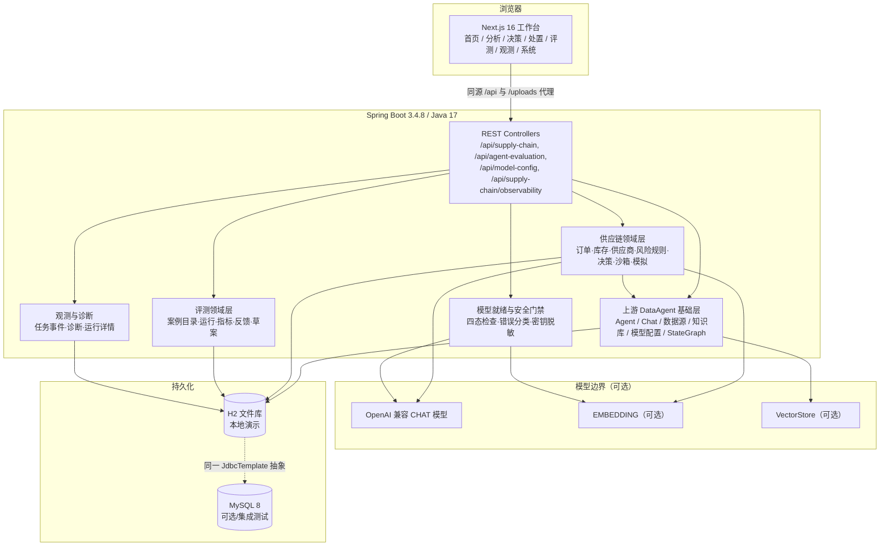
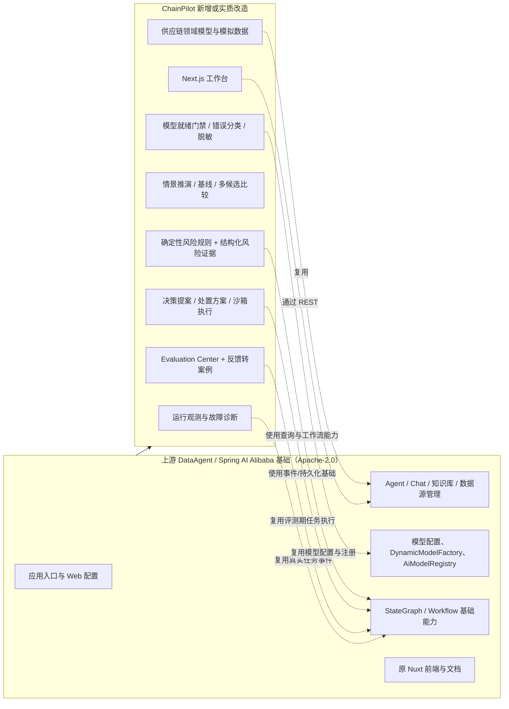
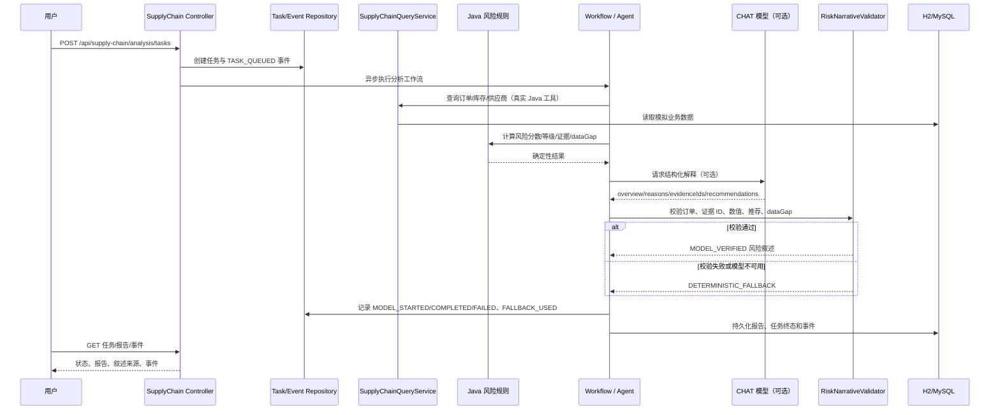
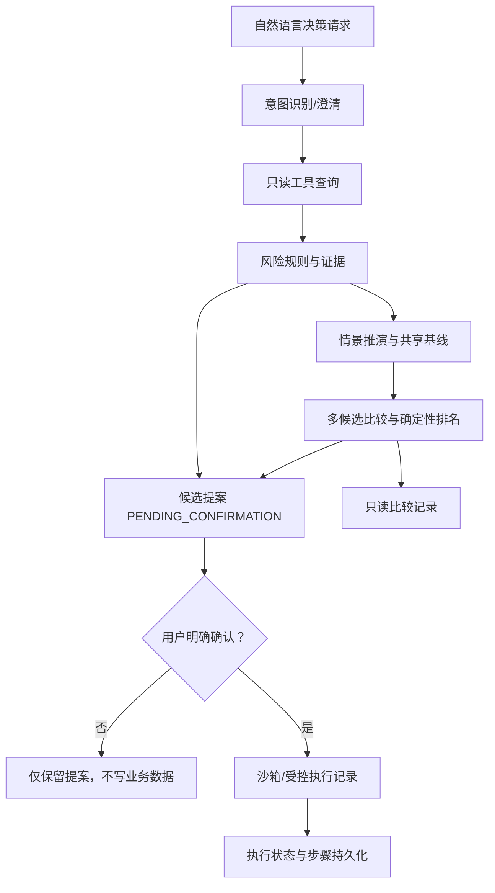
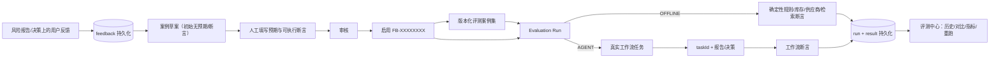
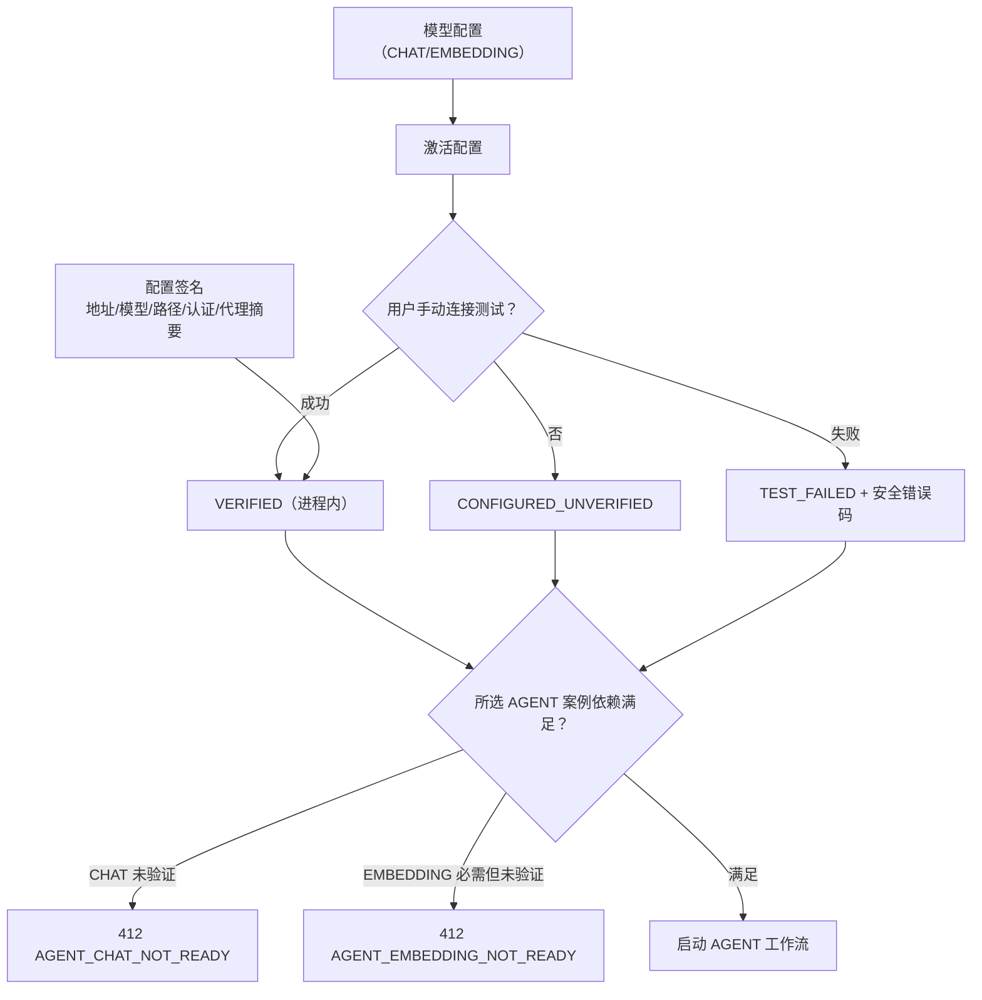

# ChainPilot 架构说明

本文描述当前仓库实际实现的 ChainPilot 架构。基础应用骨架来自
[Spring AI Alibaba DataAgent](https://github.com/spring-ai-alibaba/DataAgent)；
供应链、评测、反馈、观测和 Next.js 工作台是本地新增或实质改造部分。贡献边界见
[UPSTREAM_AND_CONTRIBUTION.md](UPSTREAM_AND_CONTRIBUTION.md)。

## 1. 总体架构



- Next.js 只通过 HTTP API 访问后端；浏览器同源代理由
  `data-agent-frontend-next/next.config.ts` 配置。
- Java 17、Spring Boot 3.4.8、Spring AI 1.1.2、Spring AI Alibaba 1.1.2.2 是当前构建版本。
- H2 是本地演示默认 profile；MySQL 用于隔离集成测试和可选部署，不要求演示时启动。
- CHAT/EMBEDDING 是可选外部依赖；没有模型时确定性路径仍然可以运行。

## 2. 上游基础与 ChainPilot 扩展边界



边界说明：

- 不删除或替换上游 LICENSE、版权声明和工作流/模型基础设施。
- 不把上游已有的 Agent、Chat、知识库、数据源管理页面宣称为本项目原创。
- ChainPilot 的重点新增是供应链业务层、评测闭环、观测层和新的 Next.js 工作台。
- 未发现可验证的上游 PR 记录；不能声称已向原仓库提交贡献。

## 3. 风险分析主流程



重要不变量：

1. 风险分数、等级、评分贡献和证据由 Java 规则产生。
2. 模型只能解释已有上下文，不能修改正式评分。
3. 未知订单/证据、无依据数值、执行声明、缺失 dataGap、非法推荐都拒绝。
4. 校验失败或异常回退 `DETERMINISTIC_FALLBACK`，不标记 `MODEL_VERIFIED`。
5. `MODEL_STARTED`、`MODEL_COMPLETED`、`MODEL_FAILED`、`FALLBACK_USED` 关联同一 taskId。

## 4. 决策、情景推演与沙箱边界



隔离原则：

- 订单、库存、供应商是 `SupplyChainDemoData` 的模拟数据，不是真实生产数据。
- 模拟执行和候选比较只写 ChainPilot 自己的模拟/比较表，不写真实库存或订单。
- 沙箱执行有显式的确认和资格边界；成功记录仍不代表真实 ERP/WMS 写入。
- `realDataMutated=false` 是决策结果的一部分，不能被模型改写成“已执行”。

## 5. 评测与人工反馈闭环



- OFFLINE 运行不调用模型，最多 20 个案例。
- AGENT 运行必须显式确认，最多 5 个案例、20 分钟超时、进程内单实例锁。
- 反馈不是标准答案；草案初始不自动生成通过条件。
- 追踪链：`feedbackId → evaluationCaseId → evaluationRunId → 实际结果`。
- 当前 14 个 OFFLINE、6 个 AGENT 内置案例和已启用反馈案例使用同一执行入口。

## 6. 模型就绪、依赖与安全门禁



- 连接测试结果保存在当前后端进程；重启后回到未验证，不读取长期成功布尔值。
- 配置变化（包括 API Key/代理凭据）会使签名失效。
- 前端禁用只是提示；后端按所选案例依赖强制校验，不能通过直接 API 绕过。
- 连接错误分类为 `AUTHENTICATION_FAILED`、`CONNECTION_TIMEOUT`、`ENDPOINT_UNAVAILABLE`、
  `INVALID_MODEL_CONFIGURATION`、`UNSUPPORTED_RESPONSE`、`RATE_LIMITED`、
  `CONNECTION_TEST_FAILED`；消息和日志经过凭据脱敏。

## 7. 观测与事件模型

事件写入 `chainpilot_task_event`，包含事件 ID、taskId、序号、类型、阶段、状态、时间、
耗时、简短摘要和错误类型。典型事件：

```text
TASK_QUEUED → TASK_STARTED → NODE_STARTED/COMPLETED
  → TOOL_STARTED/COMPLETED/FAILED
  → MODEL_STARTED → MODEL_COMPLETED/FAILED → FALLBACK_USED
  → TASK_COMPLETED/FAILED
```

- 事件来自实际执行路径，不使用前端伪造。
- Observability 汇总只基于持久化任务和事件；模型 usage 在 provider 返回时记录，
  否则写 `token usage unavailable`，不估算 token 或成本。
- 前端提供汇总、运行列表、单任务时间线、模型/工具/回退诊断和任务详情跳转。

## 8. 数据与部署边界

| 数据 | 用途 | 是否真实业务数据 |
| --- | --- | --- |
| `SupplyChainDemoData` | 订单、库存、供应商演示 | 否，本地模拟 |
| `chainpilot_analysis_task` / 事件表 | 任务与事件追溯 | ChainPilot 自身运行数据 |
| `chainpilot_disposal_*` | 决策/方案/模拟/比较/执行 | ChainPilot 模拟记录 |
| `chainpilot_evaluation_run` / `chainpilot_evaluation_case_result` | 评测运行与结果 | ChainPilot 评测记录 |
| `chainpilot_feedback*` | 用户反馈与草案 | ChainPilot 运行数据 |
| H2 文件库 | 本地演示默认持久化 | 本地数据，不提交 |
| MySQL `chainpilot_mysql_it` | 隔离集成测试 | 专用测试库，不作为生产库 |

部署端口：后端 `8065`；Next 开发默认 `3000`，生产验收使用 `3002`。Next 将
`/api/**`、`/uploads/**` 反代到 `CHAINPILOT_BACKEND_URL`。

## 9. 当前状态与不可宣称事项

- 模型配置列表为空；没有完成真实模型 Agent E2E，也没有真实 provider usage 或费用证据。
- H2/MySQL/假模型/前端测试通过，只能说明确定性路径、持久化、Mock 边界和 UI 契约；
  不能替代真实模型质量或生产性能验证。
- 沙箱不是真实 ERP/WMS 执行器。
- 连接测试状态不是跨重启持久事实。
- 当前没有可核实的上游 PR 记录。

## 10. 代码入口

| 领域 | 入口 |
| --- | --- |
| 供应链查询与规则 | `data-agent-management/src/main/java/.../supplychain` |
| 评测/反馈 | `data-agent-management/src/main/java/.../evaluation` |
| 模型配置与就绪 | `data-agent-management/src/main/java/.../service/aimodelconfig` |
| 工作流与工具 | `data-agent-management/src/main/java/.../workflow`、`supplychain/service` |
| 前端页面 | `data-agent-frontend-next/src/app` |
| 前端 API | `data-agent-frontend-next/src/lib/api` |
| 只读 Smoke Test | `scripts/chainpilot-smoke-test.ps1` |
| 评测案例资源 | `data-agent-management/src/main/resources/evaluation` |
